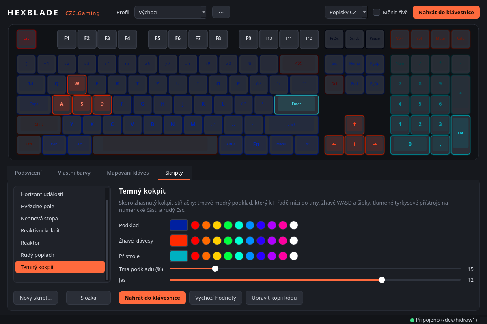

# Hexblade pro Linux

Nativní software pro klávesnici **CZC.Gaming Hexblade** (čip SONiX, USB
`0c45:8006`). Náhrada za původní windowsový program *CZC G GK1000*.



> Neoficiální projekt, není nijak spojený s CZC.cz. Protokol byl zjištěn
> reverzním inženýrstvím kvůli kompatibilitě; používáš na vlastní riziko.

Umí:

* **19 světelných efektů** z firmwaru: barva nebo duha, jas, rychlost, směr
* **vlastní barvu každé klávesy** (štětec, tahání myší, předvolby: WASD,
  duha, přechod dvou barev…), vypnutí podsvícení
* **přemapování kláves**: jiná klávesa nebo zkratka (např. Ctrl+C,
  F13–F24 pro vlastní zkratky v KDE), multimédia, tlačítka myši, vypnutí
  klávesy
* **profily** (automaticky se ukládají, import a export do JSON)
* živý náhled a okamžité posílání změn do klávesnice
* příkazovou řádku pro skripty

Nastavení se ukládá přímo do klávesnice, takže po zapsání funguje i bez
běžícího programu a na jiném počítači.

## Instalace

Potřebuješ Python 3.10+ a PySide6 (na Arch/CachyOS balík `pyside6`,
na Debianu/Ubuntu `python3-pyside6`, jinak `pip install PySide6`).

```bash
git clone https://github.com/Matys134/hexblade.git
cd hexblade
./install.sh
```

Skript nainstaluje udev pravidlo (přístup ke klávesnici bez roota; jediný
krok, který chce sudo), spouštěč `~/.local/bin/hexblade` a položku „Hexblade“
do menu aplikací.

## Použití

Grafické rozhraní: spusť **Hexblade** z menu, nebo `hexblade`.

* **Podsvícení**: vyber efekt, barvu, jas, rychlost a směr. Když je zapnuté
  „Měnit živě“, změny se hned posílají do klávesnice.
* **Vlastní barvy**: kliknutím nebo tažením přes klávesy je obarvíš štětcem,
  Ctrl+klik vezme barvu klávesy do štětce.
* **Mapování kláves**: klikni na klávesu, vyber funkci a dej „Přiřadit“.
  Mapování se do klávesnice zapíše až tlačítkem **Nahrát do klávesnice**
  (Ctrl+S). Tečka na tlačítku znamená, že v klávesnici ještě není.

* **Skripty**: návrhy podsvícení napsané v Pythonu. Parametry každého
  skriptu (barvy, posuvníky, volby) se v aplikaci samy zobrazí jako ovládací
  prvky a náhled se hned překreslí. „Upravit kód“ otevře skript v editoru
  (u vestavěných si vytvoří kopii) a po uložení se změny hned načtou.

### Skripty

Vestavěné temné sci-fi návrhy: *Temný kokpit*, *Horizont událostí* (černá
díra), *Hvězdné pole*, *Datový déšť*, *Rudý poplach* a reaktivní efekty běžící
v klávesnici: *Neonová stopa* (rozsvítí se stisknutá klávesa), *Reaktor*
(vlna od stisknuté klávesy) a *Reaktivní kokpit* (tmavě modrý podklad
a reakce na stisk).

Reaktivní efekty umí i **barvu pozadí** mezi stisky (v záložce Podsvícení
„Barva pozadí mezi stisky“, ve skriptu `kb.effect(..., background=...)`).
Je to skrytá funkce firmwaru, kterou původní software nepoužívá. Pozadí je
vždy jen jednobarevné: vlastní barvy kláves a reakci na stisk klávesnice
spojit neumí.

Vlastní skripty patří do `~/.config/hexblade/scripts/`. Nejjednodušší
začátek je tlačítko „Nový skript…“, které vytvoří šablonu s popisem API:

```python
from hexblade.fx import gradient, dim

NAME = "Můj návrh"
PARAMS = {"barva": {"type": "color", "default": "#0040ff", "label": "Barva"}}

def build(kb, p):
    kb.map(lambda k: dim(p.barva, 0.4 + 0.6 * k.cx))   # přechod zleva doprava
    kb.set("wasd", "#ff3000")
    # nebo animovaný efekt z klávesnice: kb.effect("ripples", color=p.barva)
```

Skript vytvoří návrh, který se do klávesnice zapíše jednou. Plynulé animace
počítané v počítači nejsou možné: klávesnice ukládá podsvícení do flash
paměti (častým zápisem by se opotřebovala) a jeden zápis trvá asi 0,3 s.
Pro pohyb proto skripty používají efekty, které běží přímo v klávesnici.

Tip: LED pod zhruba 30 % jasu skoro nesvítí.

Příkazová řádka:

```bash
hexblade info                              # najde klávesnici
hexblade modes                             # seznam efektů
hexblade light static -c ff0000            # statická červená
hexblade light spectrum -s 8 -b 12         # spektrum, rychlost 8, jas 12
hexblade light breath -c 00aaff            # dýchání
hexblade light off                         # zhasnout
hexblade scripts                           # skripty a jejich parametry
hexblade script hvezdne_pole -p seminko=7  # spustit skript s parametrem
hexblade script temny_kokpit --save        # … a uložit do aktivního profilu
hexblade apply "Hraní"                     # nahrát uložený profil (jen podsvícení)
hexblade apply "Hraní" --keymap            # … i s mapováním kláves
```

Profily jsou v `~/.config/hexblade/profiles/*.json`.

## Stav a omezení

* Ověřeno na klávesnici: podsvícení (efekty, barvy, jas, vlastní barvy
  kláves), pozice všech LED a mapování kláves (multimediální funkce).
* Mapování na tlačítka myši, zkratky s modifikátory a vypnutí klávesy
  vychází z původního softwaru, ale na klávesnici zatím vyzkoušené nebylo.
* Při každém zápisu mapování se přepíše celé mapování v klávesnici, včetně
  kláves přemapovaných dřív původním programem ve Windows. Takové klávesy si
  v aplikaci nastav znovu, než mapování poprvé nahraješ.
* Směry efektů jsou zatím jen „1–4“; jejich význam se u jednotlivých efektů
  liší.
* Makra zatím nejsou, protokol je ale popsaný v `docs/PROTOCOL.md`.

Popis protokolu je v [docs/PROTOCOL.md](docs/PROTOCOL.md).

## Licence

[MIT](LICENSE)
